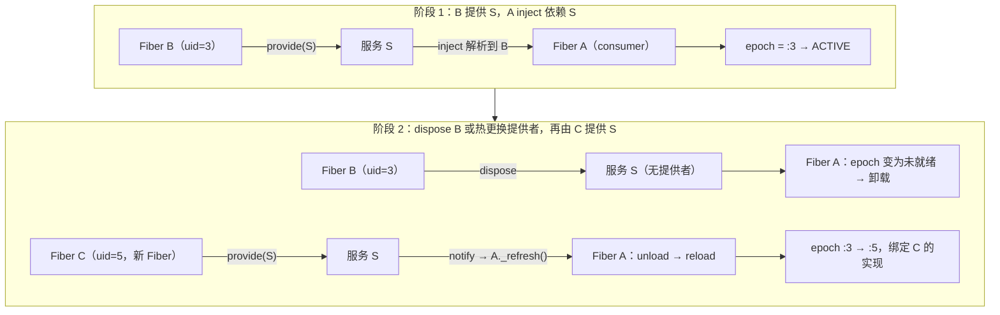
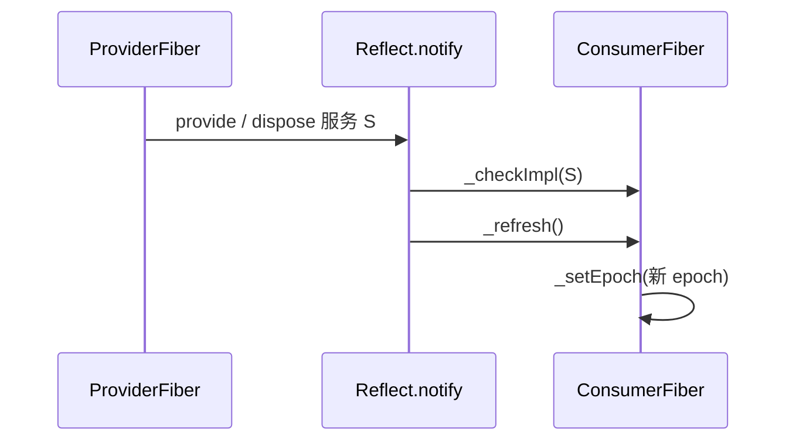

# Fiber 的 epoch、依赖链指纹与 uid

## 1、一句话

**Fiber 用 `epoch` 记录「当前依赖由哪些提供者 Fiber（uid）组成」；依赖变了就卸再载，没变就不动。插件级 HMR 与 inject 懒加载都建立在这套检测之上的，所以我们优先看看这个机制是如何实现的。**


## 2、前置校准

| 概念 | 一句话 |
|------|--------|
| 插件 | 在 Fiber 生命周期里执行 `apply(ctx, config)`（或带 `inject` 的对象插件） |
| `inject` | 声明「我依赖哪些服务名」→ `_refresh` 只遍历这些名字 |
| `ctx.provide` | 注册某个服务的实现 → 会 `notify` 所有声明了该依赖的 Fiber |
| Fiber | 一个插件实例的运行时壳：`uid`、`epoch`、`state`、`dispose` |

**链路（全文共用）**：




## 3、`epoch` 「依赖链指纹」与 Fiber 状态

3.1 依赖指纹：**`epoch` 是 `_runner.epoch` 上的字符串**，依赖没齐时，epoch 会被设为固定串 **`'__INACTIVE__'`**（cordis 源码常量名 `INACTIVE`，勿与下面的 `state` 混淆）。

3.2 Fiber 生命周期 **`state`**（`FiberState`，共 6 个）：

| 状态 | 含义 |
|------|----------------|
| **PENDING** | 依赖未齐或尚未完成加载；`epoch === '__INACTIVE__'` 且未在异步 load/unload 中时，`_getState()` 会落在此态 |
| **LOADING** | 正在 `_reload()`：依赖已就绪，插件 `apply` / 构造函数逻辑执行中 |
| **ACTIVE** | 已加载并在运行；`epoch !== '__INACTIVE__'` 且无 `_error` 时，稳定态为此 |
| **UNLOADING** | 正在 `_unload()`：清理 effect、注销 provide 等 |
| **FAILED** | 加载或配置校验失败（`_error` 有值）；epoch 可能被置回 `'__INACTIVE__'` |
| **DISPOSED** | 已 dispose，`uid === null`，不可再使用 |

常见顺序：**PENDING → LOADING → ACTIVE**；依赖变或 dispose 时经 **UNLOADING**；失败进 **FAILED**；彻底销毁进 **DISPOSED**（与 UNLOADING 可衔接，见 `fiber.dispose`）。

| `_runner.epoch` 取值 | 含义 | 对应的 `state`（简化） |
|------|------|------------------|
| `'__INACTIVE__'`（未就绪 epoch） | 至少有一个 `inject` 依赖**尚未就绪** | 稳定时多为 **PENDING**；过渡时可能是 LOADING / UNLOADING |
| 形如 `:3:7:12` 的字符串 | **依赖链指纹**：各依赖提供者 Fiber 的 `uid`，按 `Object.keys(inject)` 顺序用 `:` 拼接 | 稳定时 **ACTIVE** |
| `''`（空字符串） | `inject` 为空对象时 `_refresh` 的结果 | 无依赖，epoch 仍算已就绪（不是 `'__INACTIVE__'`），稳定时 **ACTIVE** |


## 4、uid：全局唯一、只增不减

接下来，我们看一下Fiber的uid是如何生成的，由于指纹链是通过uid拼接实现的，那么为了保障其的唯一性，必然需要uid全局唯一，因此：每个 Fiber 创建时从 Registry 取号，如下是相关代码；

```ts
this.uid = parent.registry.counter
```

```ts
// registry.ts
get counter() {
  return ++this._counter
}
```

| 要点 | 说明 |
|------|------|
| 分配范围 | 同一 `Registry`、同一 Node 主线程事件循环内全局自增 |
| root Fiber | `uid === 0` |
| dispose 后 | 该 Fiber 的 `uid` 置为 `null`（**DISPOSED**），**counter 不回退** |
| 设计目的 | 新 Fiber 永不复用已销毁的 uid，避免 epoch 与「旧提供者」撞车 |
| 线程边界 | 主线程下 `++counter` 无需原子操作；Worker / 子进程各自 Registry |

---

## 5、我们看一下，指纹到底怎么算的：`_refresh`

根据当前 `_store`（已解析的依赖实现）重算 epoch，再交给 `_setEpoch`：

```ts
_refresh() {
  let epoch = ''
  for (const name of Object.keys(this.inject)) {
    const impl = this._store[name]
    if (!impl) {
      epoch = '__INACTIVE__'  // 源码常量 INACTIVE
      break
    }
    epoch += ':' + impl.fiber.uid
  }
  this._setEpoch(epoch)
}
```

核心：`epoch += ':' + impl.fiber.uid` —— 这就是「指纹链」在代码里的样子。

### 5.1 那么到底是谁触发的 `_refresh`？事件驱动！

框架**不会**轮询依赖是否变化。典型触发路径与源码如下（路径：`deepseek-harness/vendor/cordis/src/`）。

**路径 1：Fiber 构造函数末尾** — 每个 `inject` 的插件进行 `_checkImpl`，最后再 `_refresh`：

```ts
// fiber.ts（构造函数末尾）
if (this.uid !== null && parent.fiber.state !== FiberState.UNLOADING) {
  for (const name of Object.keys(this.inject)) {
    this._checkImpl(name)
  }
  this._refresh()
}
```

**路径 2：`provide` / 注销服务 → `notify` → 下游 `_refresh`**（序列图对应这条链）。

`provide` 注册成功后，若当前 Fiber 已是 ACTIVE，会立刻 `notify`；注销时在 disposer 里再 `notify` 一次：

```ts
// reflect.ts — ctx.provide(...) 内
this.store[key] = impl
this.ctx.fiber.store![name] = impl
if (this.ctx.fiber.state === FiberState.ACTIVE) {
  this.notify([name])
}
return async () => {
  delete this.store[key]
  const fibers = this.notify([name])
  // ...
}
```

`notify` 扫描**所有**已注册的 Fiber，谁 `inject` 里声明了该服务（即：谁依赖当前这个服务），就更新谁：

```ts
// reflect.ts — notify(names)
for (const runtime of this.ctx.registry.values()) {
  for (const fiber of runtime.fibers) {
    let hasUpdate = false
    for (const name of names) {
      if (!(name in fiber.inject)) continue
      if (!filter(fiber.ctx, name)) continue
      hasUpdate = true
      fiber._checkImpl(name)
    }
    if (!hasUpdate) continue
    fiber._refresh()
    fibers.push(fiber)
  }
}
```

**路径 3：`restart()` / 非 ACTIVE 时的 `update()`** — 显式改 epoch 后再 `_refresh`：

```ts
// fiber.ts — restart()
this._setEpoch(INACTIVE)  // 值为 '__INACTIVE__'
this._refresh()

// fiber.ts — update()，当 state !== ACTIVE 时
this._setEpoch(INACTIVE)
this._refresh()
```




## 6、`_setEpoch`：Fiber生命周期是如何轮转的

```ts
private _setEpoch(epoch: string) {
  const oldEpoch = this._runner.epoch
  if (epoch === oldEpoch) return

  this._runner.epoch = epoch
  if (this.inertia) return

  this._updateState(() => {
    // 未就绪 epoch 即 '__INACTIVE__'（源码写 INACTIVE）
    if (epoch !== '__INACTIVE__' && oldEpoch === '__INACTIVE__') {
      this.inertia = this._reload()
      return FiberState.LOADING
    } else {
      this.inertia = this._unload()
      return FiberState.UNLOADING
    }
  })
}
```

### 6.1 `inertia` 解读

Cordis 注释：`inertia` = **The in-flight load/unload transition**（当前正在进行的 load/unload 过渡）。

- `_reload()` / `_unload()` 是**异步**的，返回的 **Promise** 挂在 **`inertia`** 上。
- **`inertia` 有值** ≈ 当前正有一轮 load/unload **还没跑完**。
- 此时再进 **`_setEpoch`**：会**先把新 epoch（指纹）写入** `_runner.epoch`，然后 **`if (this.inertia) return`** —— **不再**走后面的 `_updateState`，也就是**不会在这时刻再启动**新一轮 `_reload` / `_unload`（避免叠两次异步过渡）。
- 在途 Promise **收尾**时会看**最新的** `_runner.epoch`：与进入任务时一致则清 `inertia` 并落稳；若指纹已又变，则链式 `_unload` / `_reload` 追到最新依赖。inertia 期间若再次 `notify`，仍可能 `_refresh` → `_setEpoch`，继续只更新 epoch、等当前链收尾。

### 6.2 epoch 全生命周期

``` _setEpoch 同步（fiber.ts）
依赖变更 notify → _refresh()
    │
    │ reflect.ts:326
    ▼
_setEpoch(newEpoch)
    │
    │ fiber.ts:625  newEpoch === oldEpoch → return（不重复 reload）
    ▼
写入 _runner.epoch
    │
    │ fiber.ts:629  inertia 非空 → return（仅更新指纹，§6.1）
    ▼
判断：new 有效 且 old 为 '__INACTIVE__' ?
    │
    ├─ 是 → 走下方「_reload 链」（懒加载：依赖刚齐）
    └─ 否 → 走下方「_unload 链」（依赖丢 / 指纹变 :A→:B）
```

``` _reload 链（异步）
this.inertia = _reload()
    │
    │ fiber.ts:632  state → LOADING
    ▼
capture oldEpoch
    │
    │ fiber.ts:648
    ▼
执行前 epoch 仍 === oldEpoch ?
    │
    │ 否 → 跳过 apply（指纹已在 inertia 期间又变）
    ▼
_resolveConfig + 执行 apply
    │
    │ fiber.ts:654-656
    ▼
收尾 epoch 仍 === oldEpoch ?
    │
    ├─ 是 → inertia 清空 → state ACTIVE
    └─ 否 → 进入「_unload 链」（epoch 已变）
```

``` _unload 链（异步与收尾）
this.inertia = _unload()
    │
    │ fiber.ts:635  state → UNLOADING
    ▼
清理 disposables（effect / provide 等）
    │
    │ fiber.ts:676-687
    ▼
收尾：当前 epoch 为 '__INACTIVE__' ?
    │
    ├─ 是 → inertia 清空 → state PENDING（依赖丢失）
    └─ 否 → 再 _reload() → 回到「_reload 链」→ ACTIVE（换提供者 A→B）
```

**`_reload` 抛错** → epoch `'__INACTIVE__'` → **FAILED**；**`dispose`** → **DISPOSED**。

``` epoch 新旧 → 走哪条链
new === old
    ↓
return（不变）

old 未就绪 → new 有效指纹
    ↓
_reload 链 → ACTIVE

old 有效 → new 未就绪
    ↓
_unload 链 → PENDING

old 有效 A → new 有效 B（A≠B）
    ↓
_unload 链 → 再 _reload → ACTIVE
```

---

## 7、用到了哪些常见的设计模式呢？

### 7.1 依赖注入（Dependency Injection）

**是什么**：插件不自己 `new` 依赖实现，而是声明 **`inject`**，由框架在 Fiber 就绪后把 **`ctx` 上已 `provide` 的服务** 解析进 `_store`，再参与 `_refresh` 拼 fingerprint。

| 步骤 | 对应 |
|------|------|
| 声明依赖 | 前置表 `inject`；插件 `inject: ['xxService']` 等 |
| 注册实现 | `ctx.provide`；提供者 Fiber 在 apply 里 provide |
| 解析与指纹 |  `_checkImpl` → `_store` → `epoch += impl.fiber.uid` |
| 配置进 apply | 后面我会讲一下插件是如何配置的，会展开讲这部分 |


### 7.2 观察者（Observer）

**是什么**：当某个**服务**被注册或注销时，框架 **主动通知** 所有声明了该依赖的 Fiber。


| 步骤 | 对应 |
|------|------|
| 发布方 | `provide` / disposer 里 **`notify([name])`** |
| 订阅方 | 所有 `name in fiber.inject` 的 Fiber |
| 回调 | `_checkImpl` → **`_refresh`** → `_setEpoch`  |